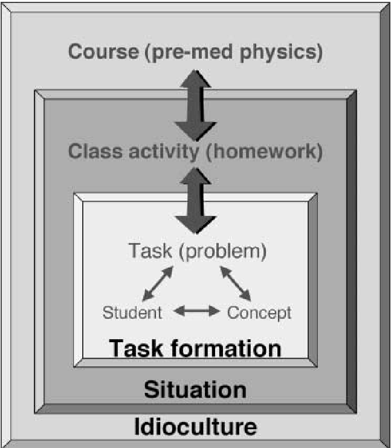
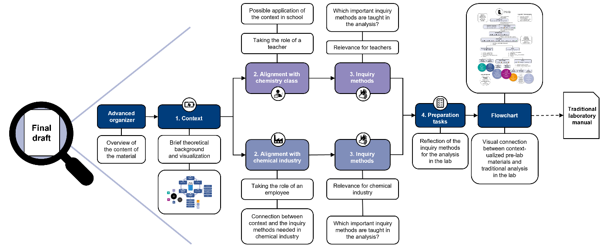

## Kontextualisierung {#sec-context author="mt"}

### Allgemeine Einführung/Beschreibung

Kontextualisierung oder kontextbasiertes Lernen (CbL) kam in den 1980er Jahren auf, um das Verständnis von naturwissenschaftlichen Phänomenen durch die Verknüpfung der zu vermittelnden Konzepte mit *out-of-school*-Situationen zu verbessern, indem das Interesse der Schüler und der Lernerfolg bezüglich der vermittelten Konzepte erhöht wird (Van Vorst & Aydogmus, 2021). Im Rahmen von kontextualisiertem Lernen werden Kontexte und naturwissenschaftliche Anwendungen im Unterricht als Ausgangspunkte verwendet, um darauf aufbauend wissenschaftliche Ideen zu entwickeln. Heutzutage wird CbL in allen Altersgruppen von der Grundschule bis zur Universität angewendet (Bennett et al., 2007). Kontextualisierung als Methodik wurde in verschiedenen nationalen Unterrichtskonzepten wie Chemistry in Context in den USA (American Chemical Society \[ACS\], 2001), Salters im UK (University of York Science education group \[UYSEG\], 2000), Industrial Science in Israel (Hofstein et al., 1999), Chemie im Kontext in Deutschland (Parchmann et al., 2006) und Chemistry in Practice in den Niederlanden (Bulte et al., 2006) implementiert. Ein Kontext kann als ein Bezugspunkt zwischen einem naturwissenschaftlichen Fachinhalt und dem Alltag verstanden werden, welcher den Lernenden die Möglichkeit gibt, einen sozialen Bezugsrahmen aufzubauen (Podschuweit & Bernholt, 2018). (Finkelstein, 2005) differenziert in seiner Definition von Kontext zwischen den drei Leveln *(idioculture, situation* und *storyline of a problem*; siehe Abb. 1), die miteinander in Beziehung stehen. (Gilbert, 2006) ergänzte dazu die Dimension *"focal event",* bei der die domänenspezifische Kommunikation von chemischen Problemen und Konzepten eingesetzt werden. Das *"focal event"* ist dabei die Basis für den zu lösenden authentischen Problemgegenstand der Unterrichtseinheit.

{fig-alt="Schema der drei Dimensionen in der Definition von Kontext nach Finkelstein (2005)"}

Abb. 1: Schema der drei Dimensionen in der Definition nach (Finkelstein, 2005).

### Befunde zur Wirkung

In der Literatur gibt es einen allgemeinen Konsens, dass sich Kontextualisierung positiv auf affektive Merkmale wie Relevanzempfinden, Interesse, Motivation und Engagement auswirkt. Bezüglich der Wirkung auf kognitive Merkmale wie konzeptionelles Verständnis und Lernerfolg gibt es keine einheitliche Literaturlage (Bennett et al., 2007; Fechner, 2009; Habig et al., 2018; Parchmann et al., 2015; Podschuweit & Bernholt, 2018; Sevian, Hugi-Cleary, et al., 2018; Van Vorst & Aydogmus, 2021). Dies liegt wahrscheinlich daran, dass der Erfolg von kontextbasiertem Lernen stark von der Qualität des eingesetzten Lernmaterials und der Implementation abhängig ist (Prins et al., 2018). Die meisten Studien fokussieren sich dabei auf die Wirkung von Kontextualisierung in der Schule, seltener in der Universität. Die Wirkung von Kontexten ist dabei auch stark vom individuellen Leistungsstand und den Interessen der Schüler abhängig, sodass unterschiedlich komplexe Kontexte bei heterogenen Lerngruppen unterschiedliche Wirkungen entfalten können (Van Vorst & Aydogmus, 2021).

### Literaturbeispiele zur Umsetzung

Insbesondere im schulischen Rahmen existieren zahlreiche Beispiele aus der Forschung zum Effekt von Kontextualisierung und der Entwicklung von Unterrichtskonzepten. Darüber hinaus gibt es auch Ansätze zur Implementation von Kontextualisierung in die universitäre Lehre. So wurden beispielsweise im Rahmen von Dissertationen an der CAU Kiel ein kontextualisiertes Anfängerpraktikum für Physik und ein Übergangskonzept von Schule zu Universität für das Fach Chemie entwickelt (Andersen, 2020; Busker, 2010). Unterschiedliche Ansätze zur Entwicklung von Kontextualisierung in der Hochschule fassen (Toan et al., 2025) zusammen.

Die Effekte von variierten Kontextaufgaben sowie der Effekt von Kontextualisierung im Allgemeinen auf das Interesses und den Lernerfolg von Schülern war ebenfalls Gegenstand von Dissertationen (Fechner, 2009; Güth, 2023). Gerade mit Hinblick auf die empirische Beforschung von Kontextualisierung im schulischen Rahmen ist die Arbeitsgruppe von Helena van Vorst (Uni Duisburg-Essen) im deutschen Raum stark vertreten. Diverse Beispiele für Unterrichtskonzepte im Rahmen von Chemie im Kontext finden sich unter anderem bei (Parchmann et al., 2006, 2015). Tiefergehende Kontextualisierungen mit Fokus auf beruflicher Orientierung wird beispielsweise in der Arbeitsgruppe von Tim Wilke zu finden.

### Umsetzungsbeispiel (Teilprojekt Kontextualisierung im Projekt DiVEx 2024-2028)

Im Projekt DiVEx (Diversitätssensible in Virtual Reality Experimentieren) wurden kontextualisierte Vorbereitungsmaterialien in einer Design-Based-Research Studie (Anderson & Shattuck, 2012; Easterday et al., 2014) für ein qualitatives anorganisches Analysepraktikum in der Studieneingangsphase entwickelt (Traub et al., 2026) um fachspezifische Denk- und Arbeitsweisen (z.B. Einstellen des pH-Wertes) zu fördern. Dabei wurden unterschiedliche Kontexte ausgewählt und Verbindungen zu schulischen und industriellen Anwendungen der vermittelten chemischen Fachinhalte aufgezeigt. Der Materialaufbau ist in Abb. 2 dargestellt. Diese Materialien wurden in einer Interventionsstudie (n = 80) mit Erstsemesterstudierenden 2025 eingesetzt und den Einfluss auf Relevanzwahrnehmung, situationales Interesse und *sense of belonging* untersucht. (Traub & Lenzer, in prep.)

{fig-alt="Aufbau des kontextualisierten Lernmaterials für die Interventionsstudie"}

Abb. 2: Aufbau des kontextualisierten Lernmaterials für die Interventionsstudie. (Traub et al., 2026)

### Umsetzungsfacetten

Bei der systematischen Umsetzung von Kontextualisierung gibt es unterschiedliche Design-Kriterien, die sich aus der Forschung ableiten lassen:

- Chemie im Kontext ((Habig et al., 2018; Nentwig et al., 2007; Parchmann et al., 2006):

  - Kontexte als authentische Startpunkte für Einheiten, die einen Alltagsbezug aufweisen sollten oder sozial bzw. gesellschaftliche relevant sein sollten

  - Strukturierung kontextualisierter Lerneinheiten erfolgt anhand von Basiskonzepten

  - Vielfältige Methoden

- Durchgehende Kontextualisierung/Kontext als "roter Faden"

Die Kontextualisierung kann dabei sowohl digital-gestützt, als auch auf klassische, analoge Lernmaterialien angewendet werden.

### Umsetzung im Prozess

Das Kriterium "Kontextualisierung" lässt sich auf der Materialebene sowie auf Ebene der Planung von ganzen Unterrichtseinheiten umsetzen. Bei der Entwicklung von kontextualisierten Lehr-Lernmaterialien sollte zunächst eine Analyse des zugrunde liegenden Lerngegenstands und der Lernziele vorgenommen werden, um im Anschluss dazu passende Kontexte auszuwählen. Zunächst sollte dann ein grober Entwurf den unterschiedlichen Stakeholdern (Schülern, Studenten, Lehrpersonal) vorgestellt werden, um die grundsätzliche Eignung der Kontexte und des Materialaufbaus zu überprüfen. Im Anschluss sollte dieser Entwurf möglichst nutzendenfreundlich ausgestaltet und verfeinert werden. Es empfiehlt sich dabei, die Relevanz der Lerninhalte explizit zu machen, da wir in unserer DBR-Studie festgestellt haben, dass nicht davon ausgegangen werden kann, dass Lernende diese Verknüpfungen von selbst herstellen. Bei der Entwicklung wurden semi-strukturierte Einzelinterviews eingesetzt, in denen die unterschiedlichen Bestandteile des Materials chronologisch evaluiert wurden. Das direkte Kommentieren innerhalb des Materials war für die Weiterentwicklung sehr hilfreich (Traub et al., 2026).

Bei der Evaluation kontextualisierter Materialien ist es hilfreich, unterschiedliche Stakeholder zu berücksichtigen. In unserem Fall stellten Fachfremde und Fachstudierende die Adressaten dar, während Fachdozierende speziell die Implementation und die fachliche Qualität evaluieren konnten und fachdidaktische Experten die didaktische Güte des Materials effektiv einschätzen konnten.

### Ansätze zur Absicherung der Umsetzung (Implementation-Check)

Kontextualisierung als Methodik lässt sich sowohl direkt als auch indirekt über andere Faktoren (wie z.B. affektive Merkmale messen). Für die direkte Messung der Güte der vorgenommen Kontextualisierung bieten sich insbesondere qualitative Methoden wie Interviews an, in denen beispielsweise die Authentizität des Kontexts und die durchgehende Kontextualisierung evaluiert wird. Dies bietet sich insbesondere für Materialentwicklungsstudien an.

Der Erfolg der Kontextualisierung lässt sich auch indirekt über die affektiven Merkmale von Lernenden im Rahmen von quantitativen Interventions- oder Materialvergleichsstudien überprüfen. Hierbei bieten sich die in der Literatur etablierten Skalen zur Messung von individuellem oder situationalem Interesse oder Skalen zur Relevanzwahrnehmung an.

Wird Kontextualisierung als Teil einer Unterrichtskonzeption eingesetzt, bieten sich darüber hinaus Unterrichtsbeobachtungen an.

### Ansätze zur Untersuchung der Wirkung (Effect-Check)

Da es sich bei Kontextualisierung um eine Methodik handelt, wird in aller Regel entweder der Kontext selbst oder die Wirkung des Kontexts beforscht. Die meisten Studien analysieren dabei die Auswirkungen auf affektive Merkmale, wobei gerade das Interesse häufig beforscht wird [z. B. @habig2018_context]. Häufig werden entweder unterschiedliche Kontexte anhand ihrer Wirkung direkt miteinander vergleichen oder im Kontrollgruppenformat beforscht, wobei eine Kohorte keine kontextualisierte Intervention erhält und somit als Kontrollgruppe fungiert. Häufig werden dazu Befragungen im Pre-Post-Format durchgeführt (z. B. Andersen, 2020; Güth & van Vorst, 2023; Sevian, Dori, et al., 2018).

### Quellen

::: sectionrefs
:::
