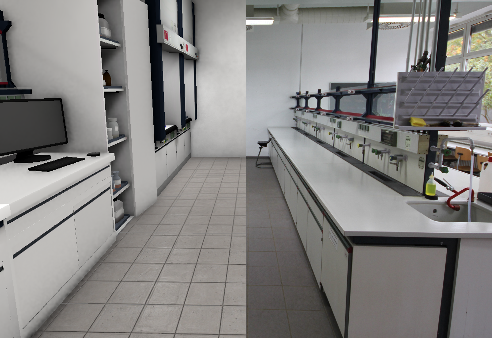
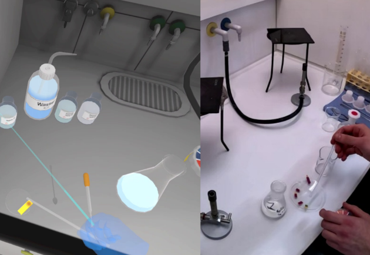

---
sec-presence:
  author:
    - ref: lm
  date: 2026-11-01
  date-modified: 2026-11-01
---

## Präsenzerleben {#sec-presence}

### Allgemeine Einführung/Beschreibung

Präsenzerleben beschreibt in Virtual-Reality-Lernumgebungen das Gefühl, sich in einer virtuellen Umgebung wie in einer echten Umgebung zu fühlen [@slater1997_framework; @witmer1998_measuring]. Es wird nach @lee2004_presence in drei Dimensionen unterschieden: physische, soziale und Selbstpräsenz. Physische Präsenz beschreibt die Wahrnehmung von Objekten als real, soziale Präsenz die Wahrnehmung als soziale Akteure und Selbstpräsenz als Wahrnehmung des virtuellen Selbst als eigenes Selbst. Die physische Präsenz, auch *spatial presence* [@wirth2007_process], kann in die Dimensionen *self location* -- sich fühlen, als wäre man in der realen Umgebung -- und *possible action* -- sich fühlen, als könnte man wie in der realen Umgebung interagieren -- unterteilt werden.

Präsenz wird durch die drei technischen Faktoren Immersion, Kontrollfaktoren und Darstellungstreue (*representational fidelity*) moderiert [@makransky2021_cognitive]: Immersion beschreibt die technische Umsetzung bzw. Darstellung (d. h. geringe Immersion ist die Umsetzung auf 2D-Bildschirmen, hohe Immersion die Umsetzung mit VR-Headsets). Die Kontrollfaktoren können nach @dalgarno2010_what durch Manipulation von Objekten, Navigation, Kontrolle der Umgebung, Kommunikation sowie Konstruktion/Scripting von Objekten beschrieben werden. Die Darstellungstreue umfasst realistische Darstellung, flüssige Blickwechsel und Objektbewegungen, konsistentes Verhalten der Objekte, Nutzendendarstellung, räumliches Audio, haptisches Feedback.

### Befunde zur Wirkung

Die technischen Faktoren (Immersion, Kontrollfaktoren, Darstellungstreue) können manipuliert werden: Der Grad der Immersion wird beispielsweise in Medienvergleichsstudien [@buchner2026_still] variiert, indem eine Version für ein VR-Headset entwickelt wird und eine andere Version für 2D-Bildschirme. In den Studien wird verglichen, wie sich der Grad der Immersion auf die Variablen auswirkt. Die Kontrollfaktoren können manipuliert werden, indem der Umfang der Interaktionen manipuliert wird und die Lernenden unterschiedlich viele Interaktionen durchführen können. Die Darstellungstreue verändert sich abhängig von der Auflösung der Texturen und 3D-Modelle allgemein.

Die technologischen Faktoren nehmen dabei Einfluss auf das Präsenzerleben, welche bei den verschiedenen affektiven und kognitiven Faktoren moderieren und dadurch Einfluss auf den Lernerfolg nehmen können [@zusho2003_skill]. Der CAMIL-framework stellt eine ...

In experimentellen Studien [z. B. @makransky2019_adding] wurde der Grad der Immersion manipuliert, indem Lernende ein virtuelles Labor entweder am Computerbildschirm oder mit einem VR-Headset durchliefen. Ein typischer Befund ist ein Immersions-Paradox: Das HMD führt zu höherer Präsenz, aber zu geringerem Wissenserwerb und höherer kognitiver Belastung als die Desktop-Bedingung. Dieser Befund motiviert u. a. die Kritik an reinen Media-Comparison-Studien (siehe unten).

### Umsetzungsbeispiel (eigene Projekte/Forschung)

Im Projekt DiVEx (Diversitätssensible in Virtual Reality Experimentieren) wurde ein immersives Virtual-Reality-Chemielabor (iVRCL) in einer Design-Based-Research-Studie [@easterday2014_designbased] entwickelt, in dem fachspezifische Arbeitsweisen (z. B. Einstellen des pH-Wertes) trainiert werden können, bevor Lernende in das reale Labor gehen. Für die Entwicklung wurden die Designkriterien Darstellungstreue, Interaktion und Guidance berücksichtigt [@echeverri-jimenez2024_roadmap]. Dieses iVRCL wurde in einer Interventionsstudie (*n* = 80) mit Erstsemesterstudierenden 2025 eingesetzt und der Einfluss auf Stress und Selbstwirksamkeitserwartungen untersucht (Mecklenburg & Lenzer, under review).

### Umsetzungsfacetten

{#fig-presence-vergleich fig-alt="Der Vergleich des virtuellen Labors (links) mit dem realen Labor (rechts) zeigt eine sehr realistische Darstellung der Umgebung."}

#### Darstellungstreue

**Realistische Darstellung:** Um eine möglichst realistische Abbildung der Umgebung zu erreichen, wurde das Labor fotografiert, alle Objekte ausgemessen und anschließend in einer 3D-Modelling-Software erstellt (Siehe Abb. X). Die Fotos wurden als Texturen auf die 3D-Objekte gelegt, wodurch ein hohes Gefühl von Realismus entsteht. Für den Sound wurden Hintergrundgeräusche aus dem Labor gewählt, die vorher aufgenommen und beschrieben wurden.

**Flüssige Darstellung und konsistentes Verhalten der Objekte:** Wurden technisch durch eine Optimierung für Standalone-Headsets umgesetzt und sind größtenteils durch die physikalischen Berechnungen in der Unity Game Engine abgedeckt. Das Erstellen von 3D-Modellen ist technisch aufwendig und benötigt Erfahrung. Alternativ können viele 3D-Modelle online erworben werden oder mit 360°-Bildern gearbeitet werden.

**Nutzendendarstellung** haben wir keine extra eingebaut, weil Nutzende die Umgebung aus Ego-Perspektive wahrnehmen und daher keinen eigenen Avatar benötigen. In vielen Fällen ist die Darstellung eines Körpers in VR auch irreführend, weil er sich nicht wie der echte Körper mitbewegt und daher das Gefühl von Präsenz verringert.

**Räumliches Audio:** In dem iVRCL werden Geräusche wie bspw. die Brennerflamme von den entsprechenden Objekten abgespielt. Zusätzlich werden Hintergrundgeräusche zu dem Labor abgespielt.

**Haptisches Feedback:** Die Controller vibrieren leicht, wenn man das Reagenzglas in der Klemme über den Bunsenbrenner hält.

{#fig-presence-interaktion fig-alt="Umsetzung der Interaktion zum Einstellen des pH-Wertes (links) im Vergleich zu dem Video aus dem realen Labor (rechts)."}

#### Kontrollfaktoren

Für **Manipulation von Objekten** wurde auf die physikalische Simulation von Unity in Kombination mit Animationen zurückgegriffen. Für die Messung des pH-Wertes kann man beispielsweise den Glasstab an ein Gefäß halten und erhält visuelles Feedback durch die Verfärbung der Spitze. Anschließend kann man den Glasstab auf ein pH-Papier halten und das Papier verfärbt sich basierend auf dem pH-Wert der Flüssigkeit.

Die **Navigation** in der virtuellen Umgebung war sehr herausfordernd zu implementieren. Zum aktuellen Zeitpunkt gibt es fünf Möglichkeiten, die Navigation und Bewegung in der virtuellen Umgebung umzusetzen:

1)  Seated Experience/keine Bewegung: Wird in erster Linie bei 360°-Videos/Bildern eingesetzt und benötigt am wenigsten physischen Platz. Mithilfe von Pfeilen oder Bereichen kann man sich durch die virtuelle Umgebung bewegen.
2)  Bei der Teleportation werden vorher Bereiche festgelegt oder man kann sich an alle Orte auf einer Fläche teleportieren und sich damit durch die virtuelle Umgebung begeben.
3)  Mithilfe des Joysticks auf dem Controller bewegt man sich kontinuierlich durch die Umgebung. Dies ist jedoch insbesondere für unerfahrene Nutzende eine große Herausforderung und kann leicht zu Motion Sickness führen.
4)  Laufmaschinen können genutzt werden, in denen sich der Boden mitbewegt und Nutzende das Gefühl haben, sich zu bewegen, aber auf der Stelle gehen. Diese sind in der Regel sehr teuer und die Implementation aufwendig.
5)  Raumskalierte Lösungen, in denen man sich in dem gesamten physischen und virtuellen Raum bewegen kann (wie bspw. im Projekt zum virtuellen Klassenzimmer von Höft & Bernholt), hier benötigt man entsprechend große Räume zur Umsetzung.

Wir haben uns für die Teleportation in vorher festgelegte Bereiche entschieden. Anfangs hatten wir Bereiche mit einer Größe von 3 x 4 m, haben aber festgestellt, dass die physischen Räume in der Regel kleiner sind und man beim Teleportieren Probleme in der Ausrichtung erhält, wenn man keinen quadratischen Bereich hat. Schlussendlich sind wir auf 2,5 x 2,5 m gegangen, weil man dadurch einfach die automatischen Bereiche des VR-Headsets verwenden kann, nicht jedes Mal den Bereich neu zeichnen muss, weniger physischen Platz bei mehreren Nutzenden in dem gleichen Raum benötigt und es für die meisten Interaktionen vollkommen ausreichend war. Hier sollte man insbesondere die Interaktionen testen, die sich am Rand des 2,5 x 2,5 m großen Bereichs befinden und eher mit einem Kreis als mit einem Quadrat als Bereich planen. In der Überarbeitung der Anwendung haben wir zusätzlich die Möglichkeit zur Steuerung mittels Joysticks für Nutzende mit Geheinschränkung umgesetzt.

**Kontrolle der Umgebung** und **Kommunikation** wurden nicht eingebaut, weil wir einen digitalen Zwilling der realen Umgebung haben und diese nicht manipulieren wollen und es in der VR-Anwendung nicht um die Kommunikation mit anderen ging. Im Projekt des digitalen Klassenzimmers wurde der Schwerpunkt auf Kommunikation gelegt und mittels des TeachR Frameworks umgesetzt.

### Umsetzung im Prozess

Das Kriterium lässt sich auf der Materialebene umsetzen. Dazu sollte mit einem Storyboard gearbeitet werden, welches die zentralen Designkriterien, Umgebung und Interaktionen festlegt. Anschließend wird die reale Umgebung so gut wie möglich (z. B. Bilder, Videos, LiDAR Scan) festgehalten und die zentralen Interaktionen videografiert. Bei den zentralen Interaktionen sind uns viele der intuitiven Handgriffe selber nicht mehr bewusst, werden hier aber festgehalten und am Ende dafür sorgen, dass sich die Interaktion auch realistisch anfühlt. In der DBR-Studie (Mecklenburg & Lenzer, in prep.) war die realistische Umgebung anfangs schon sehr gut, aber wir haben viel an den Interaktionen gefeilt und diese überarbeitet. Dazu wurden Nutzende mit verschiedenen Hintergründen (Noviz:innen, Studierende der Chemie, Forschende in der Chemie und Chemiedidaktik) eingeladen, haben das iVRCL ausprobiert, während Bildschirmaufzeichnungen durchgeführt wurden, und wurden anschließend dazu interviewt.

### Ansätze zur Absicherung der Umsetzung (Implementation-Check)

Das Präsenzerleben lässt sich quantitativ, qualitativ und physiologisch erfassen [@grassini2020_questionnaire]:

1\. Zur quantitativen Erfassung bieten sich der Presence Questionnaire [@witmer1998_measuring], Slater-Usoh-Steed-Fragebogen [@usoh2000_using] oder der MEC-SPQ [@vorderer2004_mec] bzw. die deutsche Kurzversion [@hartmann2016_spatial] an. Die Kurzversion mit acht Items und einer 7-stufigen Likert-Skala wurde in unseren Studien verwendet (siehe @tbl-presence-kurzversion).

+-----------------+---------------------------------------------------------------------------------------------------+
| Konstrukt       | Frage                                                                                             |
+:================+:==================================================================================================+
| Self Location   | Ich hatte das Gefühl in der dargestellten Umgebung selbst vor Ort zu sein.                        |
|                 +---------------------------------------------------------------------------------------------------+
|                 | Es kam mir vor, als ob ich wirklich am dargestellten Geschehen teilgenommen habe.                 |
|                 +---------------------------------------------------------------------------------------------------+
|                 | Es war, als ob sich mein eigentlicher Standort in die dargestellte Umgebung verlagert hatte.      |
|                 +---------------------------------------------------------------------------------------------------+
|                 | Ich hatte das Gefühl in der dargestellten Umgebung selbst körperlich anwesend zu sein.            |
+-----------------+---------------------------------------------------------------------------------------------------+
| Possible Action | Die dargestellten Gegenstände wirkten auf mich, als ob ich selbst etwas mit ihnen machen konnte.  |
|                 +---------------------------------------------------------------------------------------------------+
|                 | Ich hatte den Eindruck, dass ich selbst in der dargestellten Umgebung aktiv werden konnte.        |
|                 +---------------------------------------------------------------------------------------------------+
|                 | Ich hatte das Gefühl um die dargestellten Objekte herumgehen zu können.                           |
|                 +---------------------------------------------------------------------------------------------------+
|                 | Es kam mir so vor, als ob ich in der dargestellten Umgebung tun und lassen konnte, was ich wollte |
+-----------------+---------------------------------------------------------------------------------------------------+

: Kurzversion zur Erfassung des Präsenzerlebens [@hartmann2016_spatial]. {#tbl-presence-kurzversion}

2\. Zur qualitativen Erfassung bietet sich die Beschreibung der Erfahrung mit drei Adjektiven [@reeves2021_varied] und mit offenen Items (z. B. Was hat Ihnen an dem VR-Labor gefallen? Was hat Ihnen an dem VR-Labor nicht gefallen?) an und kann mittels qualitativer Inhaltsanalyse untersucht werden (siehe @tbl-presence-kategorien).

+---------+------------------------------------+-------+------------------------+--------------------------------------------------+
| Nr.     | Main Category                      | Nr.   | Sub Category           | Description                                      |
+:========+:===================================+:======+:=======================+:=================================================+
| **1**   | **Representational fidelity**      | 1.1   | Realistic environment  | Statements about whether objects, spaces, or     |
|         |                                    |       | display                | visual elements look \"real,\" \"authentic,\" or |
|         | Degree to which the iVRCL is       |       |                        | \"like in real life\"                            |
|         | described as a real-world          +-------+------------------------+--------------------------------------------------+
|         | laboratory with characteristics    | 1.2   | Dynamic                | Comments on smooth/choppy movements,             |
|         | and behaviors, creating a coherent |       | representations        | natural/unnatural animations, or disruptions to  |
|         | and believable experience that     |       |                        | the experience due to technical transitions      |
|         | aligns with users\' expectations   +-------+------------------------+--------------------------------------------------+
|         | and mental models of the real lab. | 1.3   | Behavior consistency   | Mentions of whether objects behave as expected,  |
|         |                                    |       |                        | respond logically to actions, or follow          |
|         |                                    |       |                        | real-world rules                                 |
|         |                                    +-------+------------------------+--------------------------------------------------+
|         |                                    | 1.4   | User representation    | References to feeling present, embodied, or      |
|         |                                    |       |                        | \"being there\" through their avatar or          |
|         |                                    |       |                        | representation in the environment                |
+---------+------------------------------------+-------+------------------------+--------------------------------------------------+
| **2**   | **Learners' interaction**          | 2.1   | Object manipulation    | Statements about touching, moving, rotating, or  |
|         |                                    |       |                        | otherwise interacting with objects in the 3D     |
|         | The ways in which users can        |       |                        | environment (e.g., beakers, flask)               |
|         | actively engage with and control   +-------+------------------------+--------------------------------------------------+
|         | elements within the iVRCL,         | 2.2   | Environment control    | Comments on adjusting environmental settings,    |
|         | enabling exploration,              |       |                        | changing parameters, or modifying behavioral     |
|         | manipulation, and communication    |       |                        | attributes of the iVRCL                          |
|         | that supports the learning         +-------+------------------------+--------------------------------------------------+
|         | process.                           | 2.3   | Navigation             | References to moving through the space, changing |
|         |                                    |       |                        | viewpoints, or exploring different areas and     |
|         |                                    |       |                        | perspectives                                     |
|         |                                    +-------+------------------------+--------------------------------------------------+
|         |                                    | 2.4   | Embodied communication | Mentions of sharing perspectives, pointing at    |
|         |                                    |       |                        | objects, or communicating with peers/instructors |
|         |                                    |       |                        | about what they see in the environment           |
+---------+------------------------------------+-------+------------------------+--------------------------------------------------+

: Kategorien zur qualitativen Inhaltsanalyse zum Präsenzerleben angelehnt an die Kategorien von @dalgarno2010_what. {#tbl-presence-kategorien}

3\. Physiologische Daten (z. B. EEGs) können ebenfalls verwendet werden, der Aufwand ist für den Einsatz in chemiedidaktischen Praxisstudien jedoch hoch. Für einen Überblick siehe das systematische Review von @grassini2020_questionnaire.

### Ansätze zur Untersuchung der Wirkung (Effect-Check)

Der Einfluss von Präsenz wurde in zahlreichen Studien untersucht, insbesondere in *media-comparison*-Studien, in denen beispielsweise immersives (head-mounted display) gegen nicht-immersives (PC) Training verglichen wurde [@makransky2019_adding]. Allerdings werden diese *media-comparison*-Studien häufig wegen mangelnder Vergleichbarkeit und Erkenntnis kritisiert [@buchner2026_still]. Daher bietet es sich an, das Präsenzerleben als Mediator in Strukturgleichungsmodelle einzubeziehen, um seine Rolle im Wirkmechanismus zu prüfen.

### Quellen

::: sectionrefs
:::
