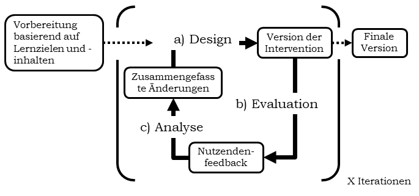
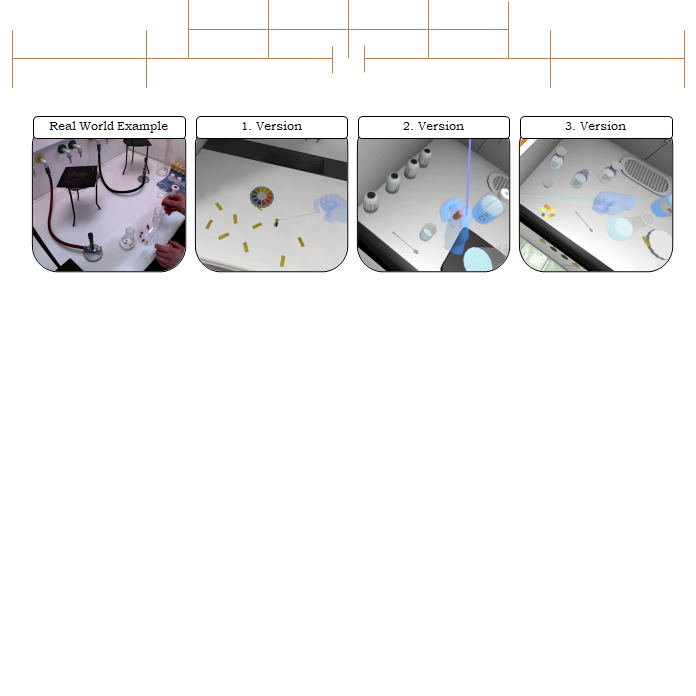

## Design-based-research {#sec-dbr author="lm"}

### Allgemeine Einführung/Beschreibung

Design-Based Research (DBR) ist ein Studiendesign, das Design- und wissenschaftliche Methoden integriert, um in realen Lernkontexten (Barab & Squire, 2004) gleichzeitig 1) praxistaugliche Interventionen und 2) theoretisch fundiertes Wissen zu generieren (Anderson & Shattuck, 2012; Easterday et al., 2014). Ann Brown (1992), die als Begründerin des DBRs gilt schrieb: *"an effective intervention should be able to migrate from our experimental classroom to average classrooms operated by and for average students and teachers, supported by realistic technological and personal support"* (Brown, 1992) und greift damit ein zentrales Problem der Bildungsforschung auf: Viele Interventionen werden für experimentelle Forschungszwecke konzeptioniert und entwickelt, aber können den Anforderungen regulärer Klassenzimmer nicht standhalten. Durch den iterativen Ansatz unter Einbezug verschiedener Perspektiven sollen Interventionen zur langfristigen Implementation entwickelt werden.

{fig-alt="Design-based-research Zyklus mit a) Design, b) Evaluation und c) Analyse."}

Charakteristisch sind iterative Zyklen aus den drei Phasen (siehe Abb. 1) - Design, Analyse und Evaluation (Mundy et al., 2024) - bzw. sechs Phasen -- focus, understand, define, conceive, build, test (Easterday et al., 2014). In der Evaluations- bzw. Testphase werden die verschiedene Perspektiven einbezogen, um die Intervention zu verbessern und theoretisches Verständnis zu gewinnen (Mundy et al., 2024). Zur Auswertung der Ergebnisse werden häufig *mixed methods* verwendet (Anderson & Shattuck, 2012).

### Befunde zur Zielsetzung

DBR setzt sich einerseits das Ziel praxistaugliche Interventionen, aber auch theoretisch fundiertes Verständnis zu generieren, um über den Einzelfall hinaus auf ähnliche Probleme angewandt werden zu können (Easterday et al., 2014). Dabei adressiert DBR die *theory-practice gap*, um Interventionen für die Praxis zu schaffen, die auch langfristig eingesetzt werden können. In ihrem Dekadenrückblick schreiben Anderson & Shattuck (2012) über die Herausforderungen von DBR, aber auch der zunehmenden Anzahl von Publikationen unter dem Schlagwort.

### Umsetzungsbeispiel (eigene Projekte/Forschung)

{fig-alt="Einblick in die Entwicklung des immersiven Virtual Reality Chemie Labor im Projekt DiVEx. Vom Videobeispiel zu finalen Version."}

Im Projekt DiVEx wurde ein immersives Virtual Reality Chemie Labor (iVRCL) in einer DBR-Studie entwickelt (Mecklenburg & Lenzer, in prep.). Dabei wurden die unterschiedlichen Perspektiven von Studierenden, Fachchemikern, Chemiedidaktikern und Novizen einbezogen. Die technische Entwicklung der VR-Umgebung erfolge in Unity Game Engine durch externe Softwareentwickler. Für die DBR Studie wurde ein Storyboard -- basierend auf vorher festgelegten Designkritierien (Echeverri-Jimenez & Oliver-Hoyo, 2024) -- mit allen erforderlichen Schritten in dem virtuellen Labor erstellt (127 Schritte). Anschließend wurden Videos zu den Versuchen aufgenommen, Bilder von dem Labor gemacht, Anleitungstexte geschrieben und Quizze erstellt. Für das Design (Schritt a in Abb. 1) wurde alles an die externen Softwareentwickler übergeben, die eine erste Version erstellten. Für die Evaluation (Schritt b) wurde die erste Version von Probandinnen mit unterschiedlichen Perspektiven getestet. Dazu wurden Screencast erstellt, welche anschließend mit den Probandinnen angeschaut und durch diese kommentiert wurden. Die Ergebnisse wurden in einem Beobachtungsbogen, basierend auf dem Storyboard festgehalten. Für die Analyse (Schritt c) wurden die Beobachtungen zusammengefasst und mittels qualitativer Inhaltsanalyse (Mayring, 2010), basierend auf den Designkriterien ausgewertet. Zusätzlich wurden kurze Videosequenzen mit Problemen erstellt und gemeinsam mit der Zusammenfassung der Änderungen (kommentiertes Storyboard) an das Entwicklerteam übergeben, woraus eine weitere Version erstellt wurde.

Neben den Interviews wurden quantitativ die kognitive Belastung (Krieglstein et al., 2023), Präsenzerleben (Hartmann et al., 2016) und Erfahrung im VR Labor (Reeves et al., 2021) erfasst. Aufgrund der geringen Stichprobe und die Veränderung der VR Umgebung über die Iterationen, konnten diese Daten am Ende nicht ausgewertet werden.

|  |  | Version of iVRCL | Participants' feedback | Commented storyboard |
|---|---|---|---|---|
| 1 | F | Virtual lab with cup boards, fume hood, glass rod, beaker, pH-paper | Realistic environment; watch glass missing; no liquids visible | Add a watch glass and shaders for liquids |
|  | I | One-button interactions with glass rod and pH-paper (steps 5+6) | Interactions feel constrained and sometimes complicated | Extend interaction, add transfer of liquid and collect base |
|  | G | Basic audio and text instructions | Instructions sometimes unclear; limited feedback | Improve guidance; add pH-paper with different colors (visual feedback) |
| 2 | F | Simple bottles for chemicals; filtration stand in fume hood | Bottles resemble solid containers; filtration stand obstructed fume hood; insufficient space | Replace with liquids bottles; automatic removal of unused equipment |
|  | I | One-button interactions with pipette for liquid transfer (step 2) | One-button handling with pipette is clumsy | Two-button interactions for grabbable objects |
|  | G | Improved guidance with some highlighted objects | More instructions and guidance towards interactions needed | Add flowchart; video VR controller usage |
| 3 | F | Liquid bottles; watch glass; automatic equipment removal | Realistic environment; no further issues | - |
|  | I | Two-button interactions for pH-measurement (steps 1 -- 8) | Two-button interactions occasionally unclear, but functional | Add videos and introduction outside of iVRCL |
|  | G | Flowchart with step-by-step instructions; videos for VR controller | More guidance (highlighting of objects) for the interactions | Scaffolding system with fading highlights of objects; revised guidance and quiz |

: Tab. 1: Übersicht über die Entwicklung der iVRCL über drei Iterationen mit dem Fokus auf die Designkritierien fidelity (F), interactivity (I), and guidance (G).

### Umsetzungsfacetten

Die systematische Umsetzung zeichnet sich in erster Linie durch den hohen Praxisbezug aus. Ziel ist es, Interventionen zu entwickeln, die auf die Bedürfnisse der Zielgruppe zugeschnitten sind und eine langfristige Implementation in die Praxis ermöglichen. Zentral ist dafür der Einbezug verschiedener Perspektiven --- Lernender, Lehrender, Forschende und weitere Stakeholder wie Softwareentwickler (Anderson & Shattuck, 2012). Dieser kooperative Ansatz unterscheidet DBR von Ansätzen, in denen Interventionen nur untersucht, aber nicht langfristig implementiert werden (Anderson & Shattuck, 2012).

Dazu werden die Versionen früh und niedrigschwellig evaluiert (Easterday et al., 2014; Mundy et al., 2024). Mittels qualitativer Methoden wie Interviews, Bildschirmaufzeichnungen und Inhaltsanalyse (Mayring, 2010) können die Perspektiven erfasst und die Usability der Intervention getestet werden. Mit quantitativen Methoden, kann die Wirkung der Intervention anschließend überprüfd werden (Anderson & Shattuck, 2012; Easterday et al., 2014).

Dabei wird die Komplexität der realen Lernsituationen (z. B. Klassenzimmer, Labor) nicht reduziert, sondern als Teil einer Feldstudie berücksichtigt. Des Weiteren, werden technische und organisatorische Herausforderungen und dessen Lösungen für eine langfristige Implementation und möglichen Transfer an andere Institutionen dokumentiert.

### Umsetzung im Prozess

Die Entwicklung von Interventionen als DBR ist aufwendig. Der Einbezug verschiedener Perspektiven, die Auswertung und Kommunikation benötigt viel Zeit. Insbesondere bei größeren Interventionen, die viel Expertise in unterschiedlichen Bereichen (z.B. bei digitalen Interventionen) lohnt sich aber das iterative Vorgehen, um eine lernwirksame Intervention zu entwickeln und die Perspektiven zu berücksichtigen.

Bei unserer Umsetzung wurde anfänglich das Storyboard basierend auf den Lernzielen und -inhalten entwickelt. Damit wurden die Videos erstellt, die als Grundlage für die technischen Entwickler -- ohne naturwissenschaftliche Kenntnisse -- wichtig waren, um die Interaktionen zu implementieren. In der Designphase, wurden literaturbasiert Designkritierien diskutiert und festgelegt (Echeverri-Jimenez & Oliver-Hoyo, 2024). Das Storyboard wurde in der Evaluationsphase als Grundlage für die Interviews genutzt, die später mittels qualitativer Inhaltsanalyse ausgewertet wurden. Die Kategorien wurden basierend auf den vorher festgelegten Designkriterien ausgewählt und anschließend für die Analyse ausgewertet. Das Storyboard war für die Kommunikation zwischen den technischen Entwicklern und uns unerlässlich.

### Quellen

::: sectionrefs
:::
