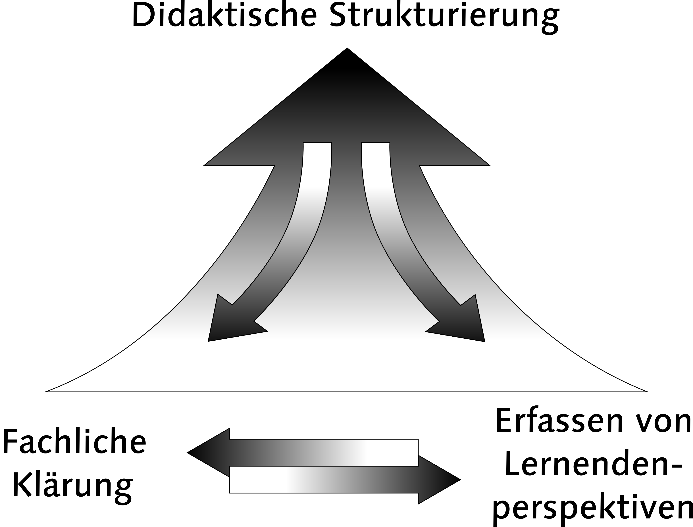

## Fachliche Klärung und Didaktische Rekonstruktion {#sec-rec author="jl" date="2026-11-01"}

### Allgemeine Einführung/Beschreibung

Während die fachliche Klärung v. a. als hermeneutisch-analytische Untersuchung eines Sach- bzw. Fachgegenstandes verstanden werden kann, so stellt sie nur einen Teil des Modells der Didaktischen Rekonstruktion (MDR) dar [@kattmann1997_modell]. Das Modell umfasst neben der fachlichen Klärung auch das Erfassen von Lernendenperspektiven sowie die didaktische Strukturierung als Verknüpfung der Ergebnisse aus fachlicher Klärung und Erhebung von Lernendenvorstellungen (ebd.).

Die *fachliche Klärung* beschreibt demnach eine inhaltsanalytisch geprägte Methode, fachwissenschaftliche Vorstellungen zu einer Thematik -- immer vor dem Hintergrund einer Vermittlungsabsicht -- zu erschließen und so Zielformulierungen für Lernende zu erarbeiten.

Die *Erfassung von Lernendenperspektiven* ist genuin empirisch geprägt und betrifft die Erhebung von Lernendenvorstellungen zu einem bestimmten Thema. Die Erhebung erfolgt, insofern nicht bereits umfassende Erkenntnisse zu Vorstellungen zu einem Thema vorliegen, in der Regel über qualitativ orientierte Fragebogen- und Interviewstudien.

Die *didaktische Strukturierung* stellt schließlich das verknüpfende Element zwischen fachlicher Klärung und der Erfassung von Lernendenperspektiven dar und lässt sich als Konstruktion von Unterricht verstehen, wobei Lernendenperspektiven als Gegebenheiten angesehen werden, von denen auszugehen ist und fachwissenschaftliche Vorstellungen den Zielbereich definieren.

Der gesamte Prozess ist aber nicht linear zu denken, sondern ist stets iterativ-wechselseitig. So kann die didaktische Strukturierung dazu führen, dass in der fachlichen Klärung mit Vermittlungsabsicht Unschärfen offengelegt werden, die nachgeschärft werden müssen (vgl. @fig-rec-modell).

{#fig-rec-modell fig-alt="Modell der didaktischen Rekonstruktion nach Kattmann et al. (1997)"}

#### Prägungen und zentrale Theorien

Das Modell der didaktischen Rekonstruktion fußt auf -- bereits zum Zeitpunkt seiner Entwicklung -- etablierten fachdidaktischen und allgemeindidaktischen Theorien der Unterrichtsplanung und der Curriculumsentwicklung. Die wichtigsten sind:

- Didaktische Analyse nach Klafki (1969), insbesondere die didaktische Prägung der Sachanalyse vor dem Hintergrund einer Elementarisierung (vgl. fachliche Analyse mit Vermittlungsabsicht)

- Das "Berliner Modell" nach Heimann, Otto und Schulz (1969), insbesondere der Gedanke einer grundlegenden Interdependenz aller Variablen, die den Unterricht bestimmen

Darüber hinaus weist es Prägungen bzw. Parallelen durch bzw. zu folgenden Theorien auf:

- *Conceptual change*: enge Anbindung an bzw. Übereinstimmung mit der *conceptual change* *theory*; didaktische Strukturierung ist darauf ausgelegt, Lernumgebungen zu schaffen, die Vorstellungsänderungen ermöglichen (d. h. Abgrenzung von einem Begriffsverständnis einer simplen Ersetzung von Vorstellungen)

- Moderater Konstruktivismus (Gerstenmeier und Mandl, 1995)

#### Schwerpunktlegungen

Die Begründer des Modells beschreiben in der zentralen Publikation [@kattmann1997_modell], dass es zwei mögliche Haupteinsatzszenarien (sozusagen zwei Schwerpunkte) gibt:

(1) Die didaktische Rekonstruktion bereits bekannter, curricular verankerter Inhalte

(2) Die didaktische Rekonstruktion neuer, bisher nicht unterrichteter Themenbereiche

### Befunde zur Wirkung

Im Vergleich zu den Qualitätskriterien des Handbuchs ist die Wirkung von entwicklungsleitenden Verfahren und Modellen, wie der hier präsentierten didaktischen Rekonstruktion, prinzipiell nicht streng auf bestimmte Zielvariablen beschränkt. Vor dem Hintergrund der Vermittlungsabsicht und dem Schwerpunkt der Vorstellungsänderung durch didaktisch strukturierte Lernangebote stehen die letztgenannten häufig im Fokus einer mit der Didaktischen Rekonstruktion verbundenen Wirkforschung. Insgesamt finden sich folgende Variablen vermehrt in Studien:

- Konzeptverständnis

  - in Form von (Fach)Wissen

  - in Form alternativer Vorstellungen

- Motivation

- Interesse

- Berufsorientierung

Diesbezügliche Studien sind schwer zu bündeln, da sie eine enorme thematische Breite umfassen und fallbezogen sind. Literaturbeispiele werden im Folgenden genannt.

### Literaturbeispiele zur Umsetzung

- @kattmann1997_modell
- Komorek, M., Wilbers, J., & Duit, R. (1997). Didaktische Rekonstruktion im Bereich Chaostheorie. In Zur Didaktik der Physik und Chemie: Tagung 1996 (S. 128--130).
- Frerichs, V. (1999). Schülervorstellungen und wissenschaftliche Vorstellungen zu den Strukturen und Prozessen der Vererbung: Ein Beitrag zur didaktischen Rekonstruktion \[Dissertation, Carl von Ossietzky Universität Oldenburg\]. Didaktisches Zentrum.
- Grospietsch, F., & Mayer, J. (2021). Didaktische Rekonstruktion als Planungs- und Forschungsrahmen nutzen: Fachliche Klärung, Gestaltung und Evaluation einer universitären Lehrveranstaltung zum Thema Gehirn und Lernen. HLZ -- Herausforderung Lehrerinnenbildung, 4(2), 165--192. <https://doi.org/10.11576/hlz-2548>
- Claussen, C. (2023). Zur Vermittlungsrolle von Naturwissenschaftsdidaktik in der forschungsbasierten Wissenschaftskommunikation: Stakeholderorientierte Weiterentwicklung eines Outreach-Formates für Schulen am Beispiel der Metaorganismus-Forschung \[Dissertation, Christian-Albrechts-Universität zu Kiel\].
- Reimann, M., Herzog, S., Parchmann, I., & Schwarzer, S. (2020). Wirksamkeit der schulischen Vor- und Nachbereitung eines Schülerlaborbesuches. In Zeitschrift für Didaktik der Naturwissenschaften, 26(1), 227--240. <https://doi.org/10.1007/s40573-020-00121-y>

### Umsetzungsbeispiel (eigene Projekte/Forschung)

In einem eigenen Projekt (ALICE) wurde das Modell der didaktischen Rekonstruktion genutzt, um (1) im Sinne der fachlichen Klärung das fachliche Wissen darzustellen, das es für den Unterrichtsgegenstand der Reaktionskinetik und des chemischen Gleichgewichts braucht und (2) in Verbindung mit gut dokumentierten Lernendenperspektiven (diese wurden nicht eigenständig empirisch erhoben) die didaktische Strukturierung einer digital gestützten Unterrichtseinheit zu realisieren. Im Sinne einer stets mitgedachten Vermittlungsabsicht kann bereits bei der fachlichen Klärung fachdidaktisches Wissen einfließen, das bspw. die Sequenzierung von Inhalten betrifft. Entsprechend wurden nach dem o. g. Schwerpunkt (1) bereits bekannte, curricular verankerte Inhalte didaktisch rekonstruiert. Ein Überblick findet sich in @lossjew2025_digital.

#### Lessons learned

Zur Erstellung der Lernumgebung wurden verschiedene Expert:innen des Chemieunterrichts sowie eine Pilotierungsklasse einbezogen. Es zeigte sich jedoch im Projektverlauf, dass die vielschichtigen Perspektiven aller teilnehmenden Lehrkräfte und ihrer Lernenden nur bedingt durch diese Maßnahmen antizipiert werden konnten. Für einen gelingenden Einsatz des Konzeptes in der Entwicklung für die Schule ist insbesondere das Einbeziehen von Lehrenden zielführend. Neben der *fachlichen Klärung* und den *Lernendenperspektiven* kann gewinnbringend die Lehrendenperspektive gestellt werden. Hierbei können sich unterschiedliche ko-konstruktive Formate eignen, wie beispielsweise *Co-Design* oder *Design-Based Research*, die letztlich auch den iterativ-wechselseitigen Anspruch des Modells der Didaktischen Rekonstruktion abbilden.

### Umsetzungsfacetten und Umsetzung im Prozess

Die systematische Umsetzung zeichnet sich explizit durch die skizzierte iterativ-wechselseitige Bearbeitung der oben beschriebenen drei Facetten des fachdidaktischen Tripletts aus. Das Dokumentieren des Entwicklungsprozesses kann dabei als Indikator für eine systematische Umsetzung verstanden werden und gleichzeitig Forschungsergebnisse generieren. Darüber hinaus können Prozessergebnisse auch weitergehend evaluiert werden -- z. B. durch Fachexpert:innen (d. h. Fachwissenschaftler:innen) und fachdidaktische Expert:innen, aber auch durch Lehrkräfte und Lernende. Je nach Fragestellung und Ziel können die genannten Stakeholder unterschiedlich stark eingebunden werden.

### Ansätze zur Absicherung der Umsetzung (Implementation-Check)

Mit Blick auf das Triplett können unterschiedliche Methoden der Absicherung gewählt werden:

- **Fachliche Klärung:** Design-Based-Research (mit evaluativen Elementen) durch Fachexpert:innen und fachdidaktische Expert:innen, Gütekriterien qualitativer Forschung bei materialanalytischem Vorgehen (vgl. hermeneutisch-analytisches Vorgehen)

- **Erhebung von Lernendenperspektiven:** Je nach Umsetzung der Erfassung/des Forschungsstandes: Gütekriterien qualitativer (z. B. dokumentatorische Transparenz des Forschungs- und Auswertungsvorgehens, Berechnung der intersubjektiven Übereinstimmung) oder quantitativer (z. B. psychometrische Gütekriterien zur Testreliabilität) Forschung

- **Didaktische Strukturierung insgesamt:** Strukturindikatoren in der Dokumentation des iterativen Prozesses durch Anwender:innen, aber auch in der Dokumentenanalyse erstellter Produkte, Design-Based-Research (mit evaluativen Elementen)

### Ansätze zur Untersuchung der Wirkung (Effect check)

Wie bereits angedeutet, kann die anvisierte Wirkforschung mit Bezug zu Materialien, die einer Didaktischen Rekonstruktion entstammen, sehr breitgefächert sein. Dies liegt u. a. auch daran, dass aus diesem Prozess in der Regel nicht ein einzelnes Material, sondern vielmehr ein Pool an Materialien entsteht. Diese Materialien können dabei auch unterschiedliche Qualitätskriterien fokussieren. Es sind demnach verschiedene Szenarien denkbar. Einige Beispiele sind im Folgenden beschrieben:

- **Interventionsdesigns mit Vergleichsgruppe:** Auf Basis neuer (ggf. sogar selbst erhobener) Kenntnisse zu Lernendenperspektiven zu einem bestimmten Fachgegenstand wird dieser neuartig didaktisch strukturiert, um die Lernendenperspektiven besser zu adressieren. In einem Interventions-Kontrollgruppen-Design kann untersucht werden, inwieweit das Aufgreifen dieser Perspektiven bspw. zu einem erhöhten Interesse im Vergleich zum "bewährten" Unterricht führt.

- **Prä/Post-Designs**: In einem Prä-Post-Vergleich in einer verbundenen Stichprobe kann untersucht werden, inwiefern das didaktisch strukturierte Lernangebot zu einer Veränderung von alternativen Vorstellungen führt. Aus dem Veränderungsmuster können Hinweise auf die Wirksamkeit der (materialgestützten) Lernumgebung abgeleitet werden. Überraschende bzw. nicht-intendierte Ergebnisse können eine iterativ-wechselseitige Überarbeitung anstoßen.

- **Qualitative Erfassung der Materialnutzung:** Erstelltes Material, das einem didaktisch rekonstruktiven Prozess entstammt, kann hinsichtlich seiner Nutzung durch Lernende untersucht werden und dabei beispielhaft folgende Fragestellungen beantworten: Welche Elemente erregen Aufmerksamkeit und unterstützen den Lernprozess in einer intendierten Weise? Welche Elemente führen zu (Verständnis)Schwierigkeiten, sind irreführend oder sogar überflüssig? Der *effect check* ist hierbei weniger streng kausal, sondern vielmehr als empirisch gestützte Rückmeldung zur Funktionalität und Wirkung der didaktischen Strukturierung zu verstehen.

### Quellen

::: sectionrefs
:::
